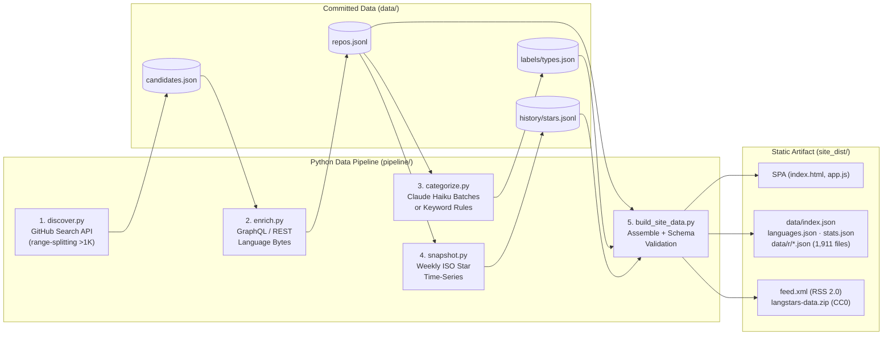

# ★ LangStars

**The most-starred GitHub repositories for every major programming language — tracked, categorized, and refreshed weekly.**

[](LICENSE)
[](https://creativecommons.org/publicdomain/zero/1.0/)
[](#current-dataset-snapshot)
[](#current-dataset-snapshot)

LangStars catalogs every non-fork GitHub repository with **20,000+ stars** across **15 programming languages** (~1,911 repositories totaling **83M+ stars**). A dependency-light Python pipeline fetches, enriches, classifies, and snapshots the ecosystem every Monday via GitHub Actions, then compiles a fast, zero-build static web app and an open CC0 dataset for GitHub Pages.

> **Same zero-backend philosophy as [SkillStars](https://github.com/agilealpha1/SkillStars)**: Python pipeline → validated static JSON + CC0 data bundle → vanilla JS SPA → GitHub Pages.

---

## Table of Contents

- [What You Can Do on the Site](#what-you-can-do-on-the-site)
- [Current Dataset Snapshot](#current-dataset-snapshot)
- [Architecture & Data Pipeline](#architecture--data-pipeline)
- [Quickstart (Local Development)](#quickstart-local-development)
- [Open Data & JSON Schemas](#open-data--json-schemas)
- [Customizing Languages & Taxonomy](#customizing-languages--taxonomy)
- [Fault Tolerance & Safety Guarantees](#fault-tolerance--safety-guarantees)
- [Testing](#testing)

---

## What You Can Do on the Site

| View / Feature | Route | Highlights |
|---|---|---|
| **Overview** | `#/` | Language tiles with official GitHub Linguist colors, active repo counts, combined stars, weekly star gains, top repository per language, **Rising This Week** leaderboard, and top 48 ecosystem topics. |
| **Language Explorer** | `#/lang/<slug>` | Sortable table (`Stars`, `Weekly Gain`, `Forks`, `Last Push`, `Age`, `Name`) + faceted filtering by **Type** (11 categories), **License**, **Topics** (multi-select AND), **Active in last 6 months**, and **Include archived**. |
| **All Languages & Fuzzy Search** | `#/all?q=...` | Instant client-side fuzzy search ([Fuse.js](https://www.fusejs.io/)) weighted across repository short name (`4×`), `owner/name` (`2×`), topics (`2×`), and description (`1×`). Every filter state is synced to the URL hash for sharing. |
| **Language Comparison** | `#/compare` | Interactive bar charts comparing languages by **Repos ≥ 20K**, **Total Stars**, or **Weekly Star Gain**, plus the top 25 fastest-growing repositories across all languages. |
| **Repository Detail Page** | `#/r/<owner>/<name>` | Interactive SVG star-history sparkline, GitHub Linguist **language byte breakdown** stacked bar (`C 98% / Assembly 1.5%`), language rank (`#1 of 64 in C`), peer recommendations, and direct links. |
| **Keyboard-First Navigation** | Press `?` | `/` focus search · `j` / `k` navigate rows · `Enter` open repo page · `o` open on GitHub · `g` / `a` / `c` jump to Overview / All / Compare · `t` toggle dark/light theme · `Esc` clear/back. |
| **RSS & Open Data** | `feed.xml` / `.zip` | Subscribe to repositories that newly cross 20,000 stars via `feed.xml`, or download the full dataset (`CSV`, `JSON`, and weekly star history `JSONL`) under `download/langstars-data.zip`. |

---

## Current Dataset Snapshot

**1,846 active repositories** (+ **65 archived**, kept and flagged) across **15 languages**, totaling **83,021,719 stars**:

| Language | Active Repos (≥ 20K ★) | Archived | Combined Active Stars | Top Repository |
|---|---:|---:|---:|---|
| **Python** | 440 | 16 | 22,634,916 | `public-apis/public-apis` (496,862 ★) |
| **TypeScript** | 377 | 10 | 18,109,943 | `freeCodeCamp/freeCodeCamp` (458,695 ★) |
| **JavaScript** | 261 | 12 | 11,086,130 | `affaan-m/ECC` (298,846 ★) |
| **Go** | 183 | 6 | 7,195,018 | `avelino/awesome-go` (192,533 ★) |
| **Rust** | 142 | 1 | 6,269,755 | `ultraworkers/claw-code` (194,948 ★) |
| **C++** | 97 | 4 | 4,071,904 | `tensorflow/tensorflow` (201,376 ★) |
| **Java** | 92 | 3 | 3,304,192 | `NationalSecurityAgency/ghidra` (98,486 ★) |
| **C** | 64 | 0 | 2,525,636 | `torvalds/linux` (254,723 ★) |
| **Shell** | 47 | 6 | 2,659,237 | `mattpocock/skills` (317,154 ★) |
| **C#** | 32 | 3 | 1,068,028 | `2dust/v2rayN` (120,135 ★) |
| **Swift** | 31 | 0 | 1,074,400 | `jaywcjlove/awesome-mac` (117,889 ★) |
| **Kotlin** | 28 | 1 | 998,937 | `2dust/v2rayNG` (65,483 ★) |
| **PHP** | 19 | 2 | 586,207 | `danielmiessler/SecLists` (74,587 ★) |
| **Ruby** | 19 | 1 | 714,403 | `rails/rails` (59,071 ★) |
| **Dart** | 14 | 0 | 723,013 | `flutter/flutter` (181,084 ★) |

---

## Architecture & Data Pipeline



### Step-by-Step Breakdown

1. **Discovery (`pipeline/discover.py` → `data/candidates.json`)**
   - Queries `language:<slug> stars:>=20000` per language.
   - **Bypasses GitHub's 1,000-result Search API cap**: whenever a query returns `total_count > 1000`, it recursively splits the star range (`split_point(lo, hi)`) until every slice fits under 1,000 results.
   - Deduplicates by immutable GitHub repository `id` (so renamed repositories preserve their identity and star history), drops forks, keeps archived repositories with `archived: true`, and verifies that the API's primary `language` field matches the target language.
2. **Enrichment (`pipeline/enrich.py` → `data/repos.jsonl`)**
   - Fetches each repository's multi-language byte breakdown (`[["C", 98000, "#555555"], ["Assembly", 1500, "#6E4C13"], ...]`).
   - **Fast path (with `GITHUB_TOKEN`)**: batches 50 repositories per GraphQL `nodes(ids: ...)` query (~40 queries for all 1,911 repos), returning exact byte sizes and Linguist colors.
   - **Anonymous fallback**: uses REST `GET /repositories/{id}/languages` within the remaining rate-limit budget, prioritizing most-starred repos first.
   - **Incremental**: reuses cached breakdowns whenever a repository's `pushed_at` timestamp hasn't changed.
3. **Categorization (`pipeline/categorize.py` + `pipeline/taxonomy.py` → `data/labels/types.json`)**
   - Assigns every repository one of **11 fixed types**: `learning`, `ai-ml`, `database`, `game`, `mobile`, `systems`, `framework`, `web`, `library`, `tool`, or `other`.
   - **Rule-based engine (default, $0)**: scores owner-written name + description phrases (`5 pts`) higher than noisy GitHub topics (`2 pts`), breaking ties toward more specific categories.
   - **Optional LLM labeling (`ANTHROPIC_API_KEY`)**: submits unlabeled or changed repositories to **Claude Haiku 4.5** via the Anthropic Message Batches API (50% batch discount; ~$0.50 for all 1,911 repos on initial run, pennies per week thereafter). Supports cross-run batch resumption via `data/labels/batch_state.json`.
4. **Weekly Star Snapshots (`pipeline/snapshot.py` → `data/history/stars.jsonl`)**
   - Appends one line per ISO week (`{"week": "2026-W45", "date": "2026-11-07", "stars": {"<repo_id>": 496862, ...}}`).
   - Re-running within the same ISO week cleanly replaces that week's entry (idempotent).
5. **Static Site & Open-Data Builder (`pipeline/build_site_data.py` → `site_dist/`)**
   - Joins `repos.jsonl`, `labels/types.json`, and `history/stars.jsonl` into a compact index (`site_dist/data/index.json`, ~289 KB gzipped), language summaries (`languages.json`), global statistics (`stats.json`), 1,911 per-repo detail files (`data/r/<owner>__<name>.json`), an RSS 2.0 feed (`feed.xml`), and the CC0 data archive (`download/langstars-data.zip`).
   - Builds inside `site_dist.tmp/`, runs strict schema and type validation (`validate()`), normalizes file permissions (`0755`/`0644`), and atomically swaps `site_dist/` into place.

---

## Quickstart (Local Development)

Requires **Python 3.10+** and `requests` (the only external Python dependency). No Node.js, npm, or bundler is required.

```bash
# 1. Install Python dependency (requests>=2.31)
make install

# 2. Build site_dist/ immediately from the committed data/ (no API calls needed)
make build

# 3. Serve locally (default http://localhost:8000/, or pick a port)
make serve PORT=8813

# 4. Run the 35 unit & integration tests
make test
```

### Running a Full Data Refresh Locally

```bash
export GITHUB_TOKEN=ghp_...          # Recommended: 30 searches/min + GraphQL language breakdowns
export ANTHROPIC_API_KEY=sk-ant-...  # Optional: Claude Haiku batch categorization

make update                          # Runs deploy/update.sh + make build
```

You can also run pipeline stages individually:

```bash
make discover                        # Or: python3 pipeline/discover.py --only Rust,Go
make enrich                          # Or: python3 pipeline/enrich.py --refresh-all
make categorize                      # Or: python3 pipeline/categorize.py --dry-run
make snapshot
make build
```

> [!TIP]
> Working without a `GITHUB_TOKEN`? `python3 pipeline/discover.py --max-seconds 150` stops cleanly with exit code `3` when the time budget is reached and resumes from `.cache/search/` on the next run.

---

## Open Data & JSON Schemas

All generated data is dedicated to the public domain under **CC0 1.0**. Once deployed (or served locally), the following endpoints are available directly as static files:

| Path | Description |
|---|---|
| `data/index.json` | Schema `v1`: `{schema, generated_at, snapshot, prev_snapshot, types, repos: [...]}`. Each repo entry contains `id`, `name`, `slug`, `url`, `desc`, `lang`, `type`, `stars`, `gain`, `forks`, `issues`, `license`, `topics`, `created`, `pushed`, `archived`, `new`. |
| `data/languages.json` | Array of language summaries: `{name, slug, color, count, archived, stars, gain, top: {name, slug, stars}}`. |
| `data/stats.json` | Global aggregates: active/archived counts, combined stars, snapshot dates, counts per type (`by_type`), label sources (`llm` vs `rules`), and breakdown coverage. |
| `data/r/<owner>__<name>.json` | Full repository detail: `description`, `homepage`, `topics`, `breakdown` (`[[lang, pct, color], ...]`), weekly `history` (`[[date, stars], ...]`), `first_seen`, and `type_src`. |
| `feed.xml` | RSS 2.0 feed of the latest 50 repositories to cross the 20,000-star threshold after the baseline snapshot. |
| `download/langstars-data.zip` | Self-contained CC0 archive containing `langstars.csv`, `langstars.json`, `languages.json`, `stars-history.jsonl`, `LICENSE.txt`, and `README.txt`. |

---

## Customizing Languages & Taxonomy

### Adding a Programming Language

Edit [`pipeline/languages.py`](pipeline/languages.py) and append a single `Lang(name, slug, color)` line:

```python
Lang('Scala',    'scala',      '#c22d40'),
Lang('Lua',      'lua',        '#000080'),
Lang('Zig',      'zig',        '#ec915c'),
Lang('Elixir',   'elixir',     '#6e4a7e'),
Lang('Haskell',  'haskell',    '#5e5086'),
```

- `name`: Exact string returned by GitHub's `language` field.
- `slug`: Search qualifier (`language:<slug>`) and URL route (`#/lang/<slug>`).
- `color`: Hex color from [github-linguist `languages.yml`](https://github.com/github-linguist/linguist/blob/main/lib/linguist/languages.yml).

### Adjusting the Minimum Star Threshold

Set the `LS_MIN_STARS` environment variable (defaults to `20000`):

```bash
LS_MIN_STARS=10000 make update
```

### Modifying Repository Types

Edit `TYPES`, `TEXT_RULES`, and `TOPIC_RULES` in [`pipeline/taxonomy.py`](pipeline/taxonomy.py). Bump `TAXONOMY_VERSION` to invalidate cached LLM labels when definitions change.

---

## Fault Tolerance & Safety Guarantees

LangStars is designed to run unattended for years without corrupting its dataset or breaking the live site:

- **Atomic file writes (`pipeline/common.py`)**: Every JSON/JSONL file is written to a temporary sibling file, `chmod`ded to `0644`, and swapped in via `os.replace()`. A crash mid-write never leaves a truncated file.
- **30% shrink guard (`pipeline/discover.py`)**: If a GitHub API outage or bad token causes discovery to return fewer than 70% of the previous run's repositories, `discover.py` aborts (`exit 1`) and leaves the previous `candidates.json` untouched (`--force` overrides).
- **URL sanitization (`safe_url()` + `httpUrl()`)**: Repository `homepage` fields are free-form user input on GitHub. Both the Python pipeline and the frontend strip `javascript:`, `data:`, and malformed URIs, upgrades bare domains (`flashml.ai` → `https://flashml.ai`), and the frontend renders all repository text exclusively through DOM `textContent` (never `innerHTML`).
- **Transactional refresh (`deploy/update.sh`)**:
  - Backups `data/` before starting.
  - If `discover.py` or `enrich.py` fails, both `candidates.json` and `repos.jsonl` are rolled back together so a new candidate list is never paired with stale enrichment data, and the weekly snapshot is skipped.
  - Paid LLM labels (`data/labels/types.json`) and in-flight batch IDs (`batch_state.json`) are preserved across rollbacks so you never pay twice for the same batch.
- **Pre-swap schema validation (`build_site_data.py:validate()`)**: Verifies every field type in `index.json`, `languages.json`, `stats.json`, all 1,911 `data/r/*.json` files, XML well-formedness of `feed.xml`, and CSV/JSON integrity inside `langstars-data.zip` before replacing `site_dist/`.

---

## Testing

Run the full test suite with standard library `unittest`:

```bash
make test
# or: python3 -m unittest discover -s pipeline/tests -v
```

| Suite | What It Verifies |
|---|---|
| `test_discover.py` | ID-based deduplication across repo renames, fork/star inclusion rules, recursive star-range splitting across 2,500 synthetic repos, primary language filtering, and `safe_url()` XSS protection. |
| `test_enrich.py` | REST and GraphQL language byte parsing, top-8 capping with accurate total bytes, and `pushed_at`-based cache invalidation. |
| `test_categorize.py` | Keyword rule scoring priority (owner description vs. topics), taxonomy completeness, LLM JSON response validation, cache-key stability, and non-destructive rule fallback. |
| `test_build.py` | End-to-end site build, schema validation, single-snapshot vs. multi-snapshot weekly gain handling, RSS feed generation, CC0 zip contents, `0644`/`0755` permissions, and atomic rollback on invalid output. |
| `test_update_sh.py` | Stubbed integration tests of `deploy/update.sh` simulating failures at `discover`, `enrich`, and `build_site_data` to verify rollback invariants and label preservation. |

---

## License

- **Code (`pipeline/`, `site/`, `deploy/`)**: [MIT License](LICENSE)
- **Dataset (`data/`, `site_dist/data/`, `langstars-data.zip`)**: [CC0 1.0 Universal (Public Domain)](https://creativecommons.org/publicdomain/zero/1.0/)
- **Vendored Search Library (`site/vendor/fuse.min.js`)**: [Fuse.js v7.0.0](https://www.fusejs.io/) ([Apache-2.0](site/vendor/FUSE_LICENSE))
